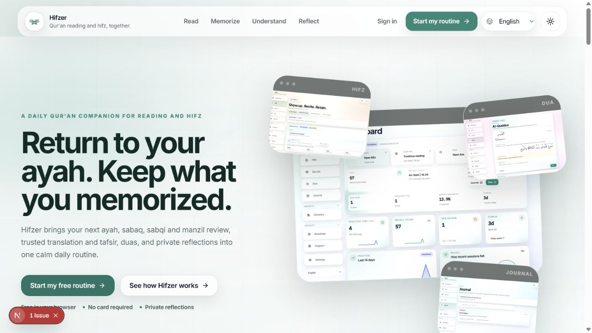
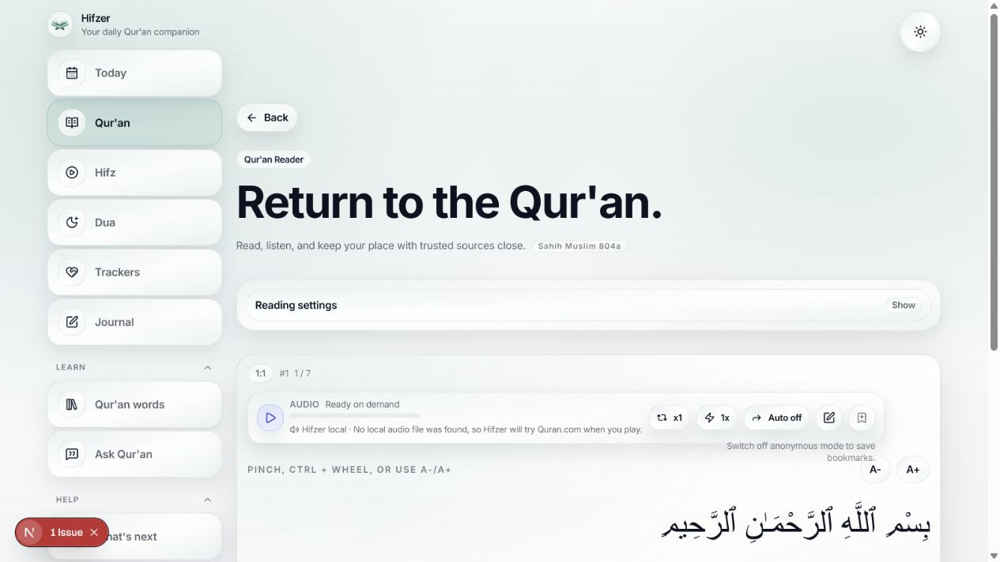
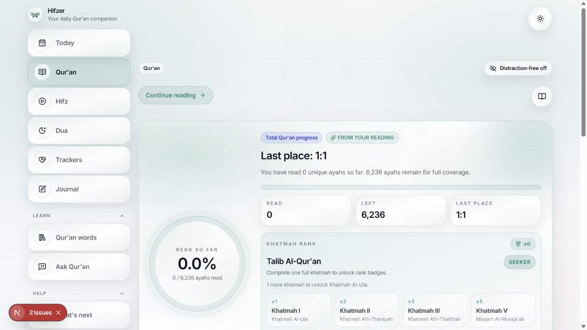
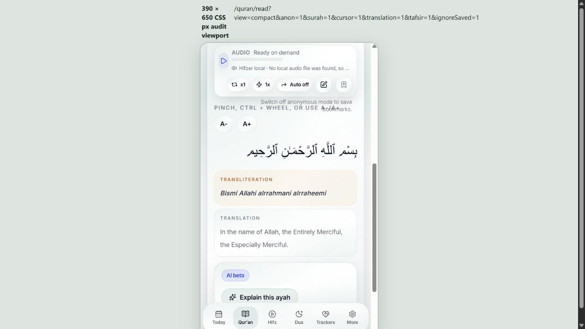
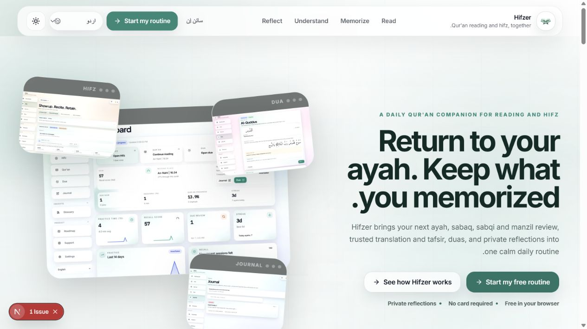
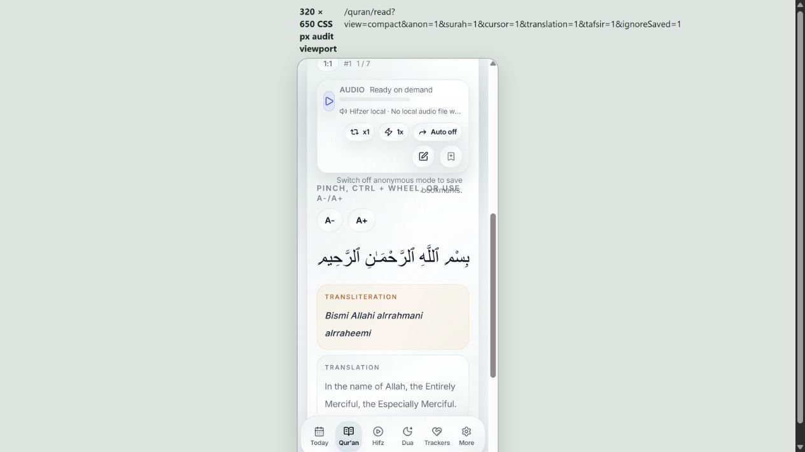
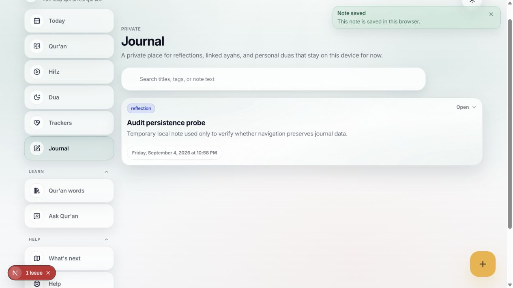
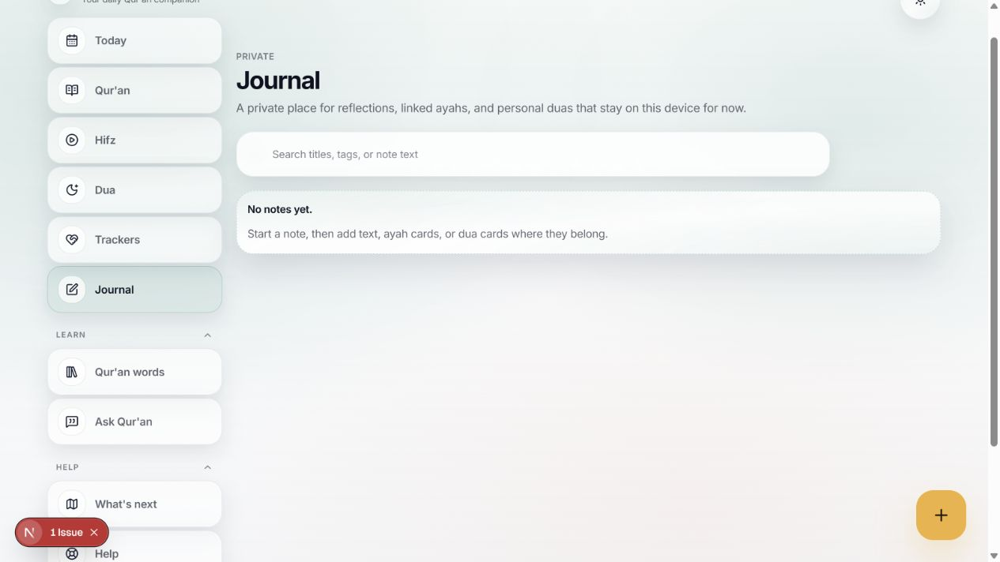

# Hifzer UI/UX audit

Date: 2026-09-04
Status: Complete within the documented access constraints

Companion deliverables: [research](research.md) · [coverage](coverage.md) · [findings](findings.md) · [target experience](target-experience.md) · [roadmap](roadmap.md)

## 1. Product and user understanding

### Confirmed product facts

Hifzer is a Qur'an-centered web companion with connected lanes for daily return, Qur'an reading, hifz and spaced review, listening, sourced explanation, guided dua, private journaling, practice, fluency, progress, reminders, billing, and support. Hifz is central but no longer the whole product.

The current implementation is a Next.js 16 / React 19 application using Tailwind CSS, shared theme and UI primitives, Clerk authentication, Prisma/Postgres persistence, optional Quran.com linking and content enrichment, a Cloudflare-hosted grounded-AI gateway, local-first audio with Quran.com fallback, and Paddle billing.

The signed-in home is **/dashboard**. The shell labels it “Today.” The deepest directly accessible surface in this audit was the Qur'an reader. The repository contains only one current end-user role; Quran.com connection and billing are account states, not separate authorization roles. Teacher-circle models exist in persistence but do not have a launched top-level interface.

### Reasonable user and job inferences

The likely primary user is a returning reader or memorizer, from beginner to experienced, who wants to:

- resume the exact Qur'an place or review queue that matters now;
- read, listen, memorize, review, or repair a weak passage without reconstructing context;
- understand an ayah through clearly distinguished Qur'an, translation, tafsir, and generated explanation;
- capture a bookmark, note, dua, or private reflection with little interruption;
- maintain a steady practice without shame or a public spiritual-status signal.

These are evidence-backed product inferences, not validated personas. No user interviews, analytics, support logs, or field performance data were supplied.

## 2. Audit scope and evidence limits

### Method

The audit sequence was:

1. Read the current product truth documents and map active routes and shared components.
2. Complete current research across Qur'an products, platform navigation, accessibility, Arabic/RTL, usability, Next.js/React interaction patterns, and field measurement.
3. Run the local application and inspect visible runtime, accessibility-tree/DOM structure, keyboard focus, responsive states, themes, localization, and implementation code.
4. Capture, save, reopen, and inspect numbered screenshots before using them as evidence.
5. Distinguish direct runtime evidence, implementation-only evidence, and inaccessible flows.

The runtime sample covers:

- desktop at approximately 1265 by 712 CSS pixels;
- compact layouts at 390 by 650 and 320 by 650 CSS pixels;
- a tablet-width sample at 768 by 650 CSS pixels;
- light and dark landing states;
- English and one Urdu/RTL landing state;
- the first keyboard focus on the skip link;
- default, expanded, disabled, validation, success, unavailable, unauthorized, and local-degraded states.

The compact and tablet screenshots were captured through a same-origin responsive audit frame. They are valid CSS-layout evidence, but the frame label and border are not part of Hifzer and the captures do not replace testing on physical touch devices or with mobile browser chrome.

### Confidence

- **High confidence:** the local journal save-then-reload data loss; visible hierarchy and copy on captured screens; compact-reader collisions; fixed-nav overlap; Khatmah rank framing; technical error text; one-click reset/discard behavior confirmed in current code; route and component inventory.
- **Medium confidence:** information-architecture and target-workflow recommendations. They are strongly supported by current product structure and external research, but not yet by Hifzer task analytics or user research.
- **Unverified:** complete signed-in onboarding, a successful dashboard day, hifz session completion, account-synced bookmarks/journal, live Quran.com connection, working audio, successful AI answers, microphone permission and recitation feedback, billing, reminder delivery, assistive-technology output, reduced-motion behavior, contrast conformance, slow-network behavior, and field performance.

### Authentication and integration blocker

Clerk, a disposable signed-in test user, database state, Quran.com credentials, audio fallback credentials, and the AI gateway were not configured in the local audit environment. Production-protected routes are therefore not equivalent to the local degraded states. The anonymous reader and several local-first surfaces were accessible; other core routes showed recovery or “Unauthorized” states.

The smallest follow-up needed for complete happy-path verification is a non-production Clerk test account plus disposable seeded Postgres data and test-safe Quran.com/audio/AI configuration. Until then, authenticated outcomes remain named blockers rather than implied successes.

This is a combined UX, visual, responsive, and accessibility-risk audit. It is **not** a WCAG conformance claim. Complete keyboard paths, screen readers, switch/voice input, computed contrast, zoom at 200 percent across full processes, physical touch targets, and production network conditions still require dedicated verification.

## 3. Overall experience verdict

Hifzer already has a distinctive strength: it feels calm, purposeful, and more respectful of Qur'anic reading than a generic productivity dashboard. The public story, anonymous-reader bridge, guided dua structure, private-journal language, and consistent visual system make the product feel coherent despite its breadth.

The most urgent gap is data integrity. The journal reported “Note saved — This note is saved in this browser,” yet the note disappeared after a normal reload (steps 37–38). Current code supplies a credible mechanism: an unresolved profile is passed to local-state ownership synchronization, where a falsy owner clears user-scoped browser data. This is a confirmed Critical release blocker for the tested local path, not a production-loss-rate claim.

The remaining high-impact gap is operational clarity at consequential moments. On compact screens, reader controls and fixed navigation compete for the same space. “Khatmah rank” and spiritual-title badges conflict with the otherwise gentle tone. Technical deployment language appears in user-facing failures, authentication recovery is inconsistent, and selecting Urdu changes the document language/direction while much of the page stays English.

The product should converge on one promise: **return to the next meaningful Qur'an action with context intact**. Progress, streaks, ranks, tools, and secondary lanes should support that action rather than compete with it.

### Representative evidence

## 4. Existing strengths worth preserving

1. **Calm, specific public positioning.** “Return to your ayah” communicates continuity better than a generic habit or achievement promise (steps 01–04).
2. **A usable guest bridge.** Sign-in and sign-up failures clearly explain what is unavailable and offer an anonymous reader rather than a dead end (steps 05–07).
3. **Respectful trust language in the marketing sample.** The landing explanation is labeled as a stored sample, keeps source context visible, and says it does not replace a qualified teacher or scholar (step 04).
4. **A strong anonymous reading baseline.** Arabic, transliteration, translation, navigation, typography controls, and settings are available without an account (steps 07–11).
5. **Immediate, dismissible success feedback.** Saving a reading plan produces a clear toast; the shared toast implementation uses a polite live region (step 14).
6. **Responsive public hero.** The landing hierarchy and stacked actions survive 390 and 320 CSS-pixel widths without horizontal scrolling in the captured first screen (steps 17 and 35).
7. **Theme support is visually coherent.** The captured dark landing keeps the same hierarchy and brand character, although full contrast measurement was outside this audit (step 02).
8. **Keyboard entry has a visible skip link.** The first Tab exposes “Skip to main content” with a clear focus indicator (step 16).
9. **Guided dua is structured and reassuring.** Modules state the goal, sequence, visit progress, and verified anchor before detail (steps 26–27).
10. **The architecture already contains useful state primitives.** Route-level loading components, a shared shell, tokenized themes, polite toast feedback, error boundaries, and prefetched likely routes create a workable foundation.

## 5. Ten highest-impact findings

The detailed register should remain the source of truth for complete evidence, affected files, effort, risks, acceptance criteria, and metrics.

| ID | Priority | Finding | Direct evidence | User consequence | Recommended direction |
|---|---|---|---|---|---|
| HF-00 | Critical | A normal reload deletes a just-saved local journal note. | 37–38 plus owner-sync code path | The interface makes a false durability promise and can destroy private work. | Separate unresolved, signed-out, and confirmed-owner transitions; never clear on unresolved identity; verify every save with read-back and add reload/account-switch regression tests. |
| HF-16 | High | The one-time checkout promise and entitlement implementation do not agree. | Billing/support copy plus Paddle webhook and feature-gate code | A successful buyer may not receive the paid state they were promised. | Define one entitlement contract, grant it from a verified one-time transaction, and test purchase-to-access end to end in Paddle sandbox. |
| HF-01 | High | Reframe devotional “Khatmah rank” badges as private, non-ranking milestones. | 12, 33, 34 | Spiritual-title and rank language can feel like a claim about devotion rather than a private reading record, undermining trust. | Keep private completion history, remove rank/title hierarchy and “unlock” language, and let people hide milestones. |
| HF-02 | High | Put the next meaningful Qur'an action ahead of aggregate progress and rank. | 12–14, 33–34; dashboard happy path blocked | A small Continue action is visually outweighed by large aggregate progress and badge surfaces, increasing choice and achievement pressure. | Lead with due review, interrupted reading, or active goal; move progress into supporting detail. |
| HF-03 | High | Repair compact-reader reflow. | 21, 22, 36 | Audio, bookmark help, font controls, and instructions collide or truncate at 320–390 CSS pixels, harming comprehension and operation. | Use stacked responsive groups, reserve text space, and verify clean reflow at 320 CSS pixels and 200 percent zoom. |
| HF-04 | High | Keep fixed mobile navigation from obscuring content and focused controls. | 18–22, 32–36 | The floating bar covers reader/settings content and can hide the active or focused control near the viewport bottom. | Reserve measured safe-area space, add scroll margins, and dock or collapse the bar in immersive reading/editing states. |
| HF-05 | High | Route missing or expired authentication to one consistent recovery state. | 24, 25, 29 | “Unauthorized” plus Retry does not explain sign-in or preserve intent, while the dashboard uses clearer alternatives. | Use a shared auth-recovery component with Sign in, Continue as guest where safe, Help, and a preserved return path. |
| HF-07 | High | Make AI trust operational, not only promotional. | 04, 11, 30–31; successful response blocked | Unavailable states provide little trusted fallback, and a successful claim-level citation/reporting path could not be verified. | Keep AI visually separate, provide resolvable sources and limitations, add report/correction controls, and fall back to official tafsir/search. |
| HF-12 | High | Complete the language/RTL and Arabic semantics contract. | 23 plus current document-language logic | Selecting Urdu sets the whole document to Urdu/RTL while most visible copy remains English, so screen readers may apply the wrong pronunciation and reading model. | Change document language only when rendered UI copy matches it; mark Arabic and mixed-language runs explicitly; complete or clearly scope localization. |
| HF-18 | High | “Private journal” lacks a defined at-rest protection and retention contract. | Journal copy/storage code and schema contrast with explicitly encrypted Zakat data | Users cannot tell what “private” means across browser, database, operators, backups, export, and deletion. | Publish and implement a scoped privacy contract; complete security/privacy review before making stronger encryption claims. |

### Compact priority matrix

Scale: impact and strategic importance may be Critical, High, Medium, or Low; confidence is High, Medium, or Low; effort is Small, Medium, or Large. Frequency reflects expected exposure, not measured Hifzer analytics.

| ID | User impact | Frequency | Confidence | Effort | Strategic importance | Priority |
|---|---|---|---|---|---|---|
| HF-00 | Critical | Medium–high | High | Medium | Critical | Critical |
| HF-16 | High | Low–medium | High | Medium | High | High |
| HF-17 | High | High | High | Medium | High | High |
| HF-18 | High | Medium | High | Medium–large | High | High |
| HF-19 | High | High | High | Medium–large | High | High |
| HF-21 | High | Low–medium | High | Small–medium | High | High |
| HF-01 | High | Medium | High | Medium | High | High |
| HF-02 | High | High | Medium | Medium | High | High |
| HF-03 | High | High on compact | High | Medium | High | High |
| HF-04 | High | High on compact | High | Medium | High | High |
| HF-05 | High | Medium | High | Medium | High | High |
| HF-06 | High | Medium | High | Small | High | High |
| HF-07 | High | Medium | Medium | Large | High | High |
| HF-08 | High | Low–Medium | High | Small–Medium | High | High |
| HF-12 | High | High for localized sessions | High | Medium–Large | High | High |
| HF-09 | Medium–High | High on compact | High | Medium | High | Medium |
| HF-10 | Medium | High in reader | High | Medium | Medium | Medium |
| HF-11 | Medium | Medium | High | Small–Medium | Medium | Medium |
| HF-13 | Medium | Medium | High | Medium | Medium | Medium |
| HF-14 | Medium | Medium | High | Small | Medium | Medium |
| HF-15 | Medium | High in reader | Medium | Medium | High | Medium |
| HF-20 | Medium | High | High | Medium | High | Medium |
| HF-22 | Medium | Low | Medium | Small | Medium | Medium |

## 6. Research-informed design direction

Research establishes direction; Hifzer screenshots and code establish each defect.

| Research-to-decision link | Applicable evidence | Hifzer decision |
|---|---|---|
| [Quran Foundation Connected Apps v1.1, 2026-08-10](https://api-docs.quran.com/docs/connected-apps/) rejects spiritual rank, shame, coercive loss aversion, and vanity good-deed ranking; it also requires AI disclosure, source separation, resolvable citations, and reporting. | 04, 11–12, 30–34 | Remove devotional rank language; keep motivation private and recoverable; make AI provenance and reporting visible in the real response and failure flows. |
| [Quran Foundation reading-session API](https://api-docs.quran.com/docs/user_related_apis_versioned/1.0.0/add-or-update-user-reading-session/) models a latest surah/ayah resume point and debounced visible-ayah updates. | 07, 12–14 | Make exact resume context the central return action and preserve mode, translation, reciter, and audio position locally and when linked. |
| [Apple tab-bar guidance, updated 2026-06-08](https://developer.apple.com/design/human-interface-guidelines/tab-bars) and [Android adaptive navigation](https://developer.android.com/develop/adaptive-apps/guides/build-adaptive-navigation) favor a small set of stable, labeled peers that adapts by width. | 18–22, 32–36 | Validate four or five compact destinations, a larger-width rail/sidebar, state preservation, and a complete More hub. |
| [WCAG 2.2](https://www.w3.org/TR/WCAG22/), [Reflow](https://www.w3.org/WAI/WCAG22/Understanding/reflow.html), and [Target Size (Minimum)](https://www.w3.org/WAI/WCAG22/Understanding/target-size-minimum) require workflow-wide accessible behavior and 320-CSS-pixel reflow, with a 24-by-24 CSS-pixel AA target floor subject to exceptions. Apple/Android guidance supports a 44–48 pixel product target. | 16, 19–22, 35–36 | Fix collisions and focus obstruction first; use 44–48 pixels as the ordinary ergonomic product target without mislabeling it as the WCAG floor. |
| [W3C HTML directionality](https://www.w3.org/International/questions/qa-html-dir.en) and the [Arabic Layout Requirements draft](https://www.w3.org/TR/alreq/) distinguish language, base direction, and mixed content. | 23 | Match the document language to rendered copy, mark Arabic content runs, use bidi isolation/logical properties, and test Qur'anic text with a specialist. |
| [NN/g dashboard guidance](https://www.nngroup.com/articles/dashboards-preattentive/) distinguishes an actionable at-a-glance home from a portal; [progressive disclosure](https://www.nngroup.com/articles/progressive-disclosure/) puts common choices before advanced detail. | 08, 12–13, 19–20 | Lead Today/Qur'an with one recommended action and move ranks, history, and advanced reader filters behind supporting detail. |
| [NN/g form-error guidance, reviewed 2024-12-12](https://www.nngroup.com/articles/errors-forms-design-guidelines/) favors noticeable, local, understandable, effort-preserving recovery. | 09–11, 24–25, 29–31 | Replace raw/native-only or technical errors with inline user-language messages, preserved input, alternatives, retry, and help after repeated failure. |
| [Next.js navigation guidance](https://nextjs.org/docs/app/getting-started/linking-and-navigating), [React transitions](https://react.dev/reference/react/useTransition), and [React optimistic UI](https://react.dev/reference/react/useOptimistic) support stable shells, pending feedback, and recoverable mutations. | 14 plus code-level loading/toast primitives | Reuse existing loading and toast foundations, add explicit pending/rollback/undo behavior, and measure route-level field performance. |

Recommended product principles:

1. One recommended meaningful Qur'an action, not a feature portal.
2. Exact continuity before aggregate achievement.
3. Reading, listening, memorizing, and reviewing have distinct progress semantics.
4. Canonical Qur'an, translation, tafsir, and generated commentary remain visibly and semantically distinct.
5. Motivation celebrates return without spiritual rank, shame, FOMO, or brittle perfection.
6. Capture first; organize bookmarks, notes, and duas after the moment is saved.
7. Compact navigation exposes only stable top-level peers and adapts across breakpoints.
8. Errors name what the user can do next, preserve effort, and keep implementation detail out of the interface.
9. WCAG 2.2 AA is the verification target; 44–48 pixels is the ordinary product target for touch ergonomics.
10. Language, direction, shaping, and mixed-script semantics are tested as separate concerns.

## 7. Recommended target workflows

### TJ-1 — First visit → realistic first plan

Landing → read anonymously immediately → create an account only when the user chooses to save → ask three short setup questions (intent/cadence, current range, review preference) → show the first recommended action → defer Quran.com connection, reminders, advanced scheduling, and microphone permission until relevant.

### TJ-2 — Return → one recommended next action

Today → one primary card chosen by evidence (due review, interrupted reading, then active plan) → begin in one action → show supporting progress, recent history, and secondary lanes below → use gentle recovery when a day is missed.

### TJ-3 — Read/listen → exact-context continuity

Resume exact ayah/page and mode → read/listen with a stable compact toolbar → disclose advanced filters on demand → capture bookmark or journal note at the ayah → show local/sync status → preserve reciter and audio position → provide plain-language recovery if enrichment is unavailable.

### TJ-4 — Practice/review → inspectable feedback and gentle recovery

Open the due queue → understand why this passage is due → attempt active recall → receive non-color-only, confidence-aware feedback → repair a weak transition → complete with a concise next-review summary. This flow remains implementation- and runtime-blocked in the current audit.

### TJ-5 — Capture → durable bookmark or reflection

Capture a bookmark, reflection, or dua without leaving the current ayah → confirm local save/sync state → return to reading immediately → organize or link later → protect dirty drafts and destructive actions with confirmation or undo → keep privacy behavior visible but quiet.

### TJ-6 — Ask → source-backed guidance and fallback

Ask or choose a suggestion → show matched ayahs and named sources before generated synthesis → keep AI clearly labeled and subordinate → open citations → report a concern or seek qualified guidance → fall back to search/tafsir when the gateway is unavailable.

## 8. Prioritized roadmap

### NOW — Protect trust (0–2 weeks)

Scope: HF-00 first, then HF-01, HF-03, HF-04, HF-05, HF-06, HF-08, HF-16, HF-21, and containment for HF-12/HF-18.

- Stop unresolved identity from clearing user-scoped local state; verify local writes by read-back and cover reload, sign-out, and account-switch transitions.
- Gate or relabel one-time checkout until a completed transaction reliably grants and verifies its entitlement.
- Distinguish instant device-only display changes from account-save success, and expose retry on failure.
- Remove rank/title language while retaining private reading history.
- Reflow reader controls at 320 and 390 CSS pixels and reserve space above the fixed nav.
- Replace raw Unauthorized/config messages with shared, intent-preserving recovery.
- Add confirmation/undo and dirty-state protection to reset, discard, and delete actions.
- Prevent a global document-language mismatch until the selected UI is actually translated.

The smallest coherent implementation slice is **S0 Trustworthy local capture**: explicit identity states → fix the owner-clearing path → shared verified save status → deterministic reload/account-switch tests. Do not begin a visual shell overhaul before this release gate passes.

The range is a planning horizon, not a delivery promise; engineering should re-estimate after component-level scoping.

### NEXT — Deliver continuity (2–8 weeks)

#### Wave A — Core journey

Scope: HF-02, HF-09, HF-10, HF-11, HF-13, HF-14, HF-15.

- Make the next action dominant on Today and Qur'an.
- Validate a five-item compact information architecture and a complete More hub.
- Replace ambiguous reader chips with explicit view/state controls.
- Replace global ayah ID with surah/ayah navigation and inline validation.
- Make mobile settings categories discoverable and keyboard-complete.
- Dock/hide the new-note action during editing and raise dense control hit regions.

#### Wave B — Adaptive shell and system foundations

- Formalize responsive shell, toolbar, sticky-nav, focus-offset, loading, error, empty, confirmation, undo, and sync-status primitives.
- Create a complete message catalog and semantic language/direction contract.
- Add visual-regression fixtures at 320, 390, 768, and desktop widths, plus dark/RTL states.
- Add product analytics for task entry, resume accuracy, recovery, and compact navigation; segment Web Vitals by route and device.

### LATER — Deepen practice and guidance (8–14+ weeks)

Scope: HF-07 plus the target daily, reader, hifz, bookmark, and journal journeys.

- Persist and reconcile full reading context.
- Implement source-first AI responses, limitations, reporting, and official fallbacks.
- Complete capture-first bookmarks and journal linking with transparent local/sync status.
- Verify hifz recall, recitation feedback, permission, low-confidence, failure, correction, and completion states.

Only after instrumentation and trust gates, validate:

- Gentle missed-day recovery.
- Adaptive daily portions after missed or ahead-of-plan sessions.
- Confidence-aware recitation correction.
- Temporary line-focus mode.
- Layered AI answers.

Run experiments only after baseline task analytics and trust/accessibility fixes are in place.

## 9. Quick wins

1. Guard the unresolved-profile path immediately so it cannot clear journal, bookmark, or pending-session storage; add the screenshot-37→38 reload regression before release.
2. Replace the visible QF_CONTENT_CLIENT_ID / QF_CONTENT_CLIENT_SECRET text with “Audio is unavailable right now,” then offer Retry, Change reciter, and Continue without audio.
3. Change “Khatmah rank,” spiritual titles, and “unlock rank badges” to neutral, private completion history while the final milestone model is designed.
4. Reuse the dashboard recovery pattern for Hifz and Trackers: explain that the session needs sign-in, preserve the return path, and provide Sign in / Open Qur'an / Help.
5. Add a confirm-or-undo guard to Reset progress, Discard, and Delete.
6. Add measured bottom padding and scroll margin for the fixed nav, then stack the compact reader utility rows below 480 pixels.
7. Stop setting the entire document to Urdu when the rendered page remains English; correctly label actual Arabic/Urdu content runs.
8. Hide or dock the journal new-note floating action while a note editor is already open.

## 10. Success metrics

Establish a baseline before implementation, then monitor:

- median and p75 time from landing or signup to the first meaningful reading/review action;
- onboarding start-to-first-session conversion and abandonment by step;
- primary Today CTA start rate and time-to-core-action;
- resume accuracy for ayah/page, mode, translation, reciter, and audio position;
- due-review start/completion and repeated-error rate by passage;
- bookmark/note capture time, revisit rate, local/sync failure, and recovery;
- verified-save read-back rate and zero known reload/account-switch data-loss reproductions;
- AI source-open, report, retry, fallback, and abandonment rates;
- authentication recovery completion and preserved-return success;
- destructive-action cancel, undo, and accidental-loss reports;
- compact-navigation task success and route-switch error rate;
- Arabic/mixed-script reflow, focus, language, and target-size verification rate;
- LCP at or below 2.5 seconds, INP at or below 200 milliseconds, and CLS at or below 0.1 at p75, segmented by route and mobile/desktop.

Targets should be confirmed against current baselines; product-task metrics and accessibility verification are not interchangeable with Web Vitals.

## 11. Risks, assumptions, and unresolved questions

### Confirmed risks

- A note explicitly reported as saved in the browser disappeared after reload; the current identity/local-store path can explain the result and requires a blocking regression test.
- The local environment cannot prove authenticated happy paths or live integrations.
- Mobile reader collisions and fixed-nav obstruction are visible at representative compact widths.
- The selected Urdu state creates a mismatch between document language and mostly English content.
- Reset/discard handlers lack a confirmation or undo safeguard in current code.

### Assumptions to validate

- Mobile return sessions are frequent enough that compact-reader and compact-nav work should lead the roadmap.
- The intended moral tone favors private consistency and recovery over status.
- Today should rank due review, interrupted reading, and active-plan work in that order or a close variant.
- Four or five compact destinations can cover most frequent switching without harming expert users.

### Unresolved questions

- Which tasks and devices dominate actual use?
- Where do people abandon onboarding, reading, hifz, and AI flows?
- How accurate and fast is recitation feedback in noisy, low-bandwidth, and mixed-accent contexts?
- Which content and UI locales are launch-critical, and who provides Arabic/Qur'anic typography review?
- What is the expected privacy, retention, and provider disclosure contract for microphone audio, journal data, and AI prompts?
- Which features are free, premium, or Quran.com-dependent in the intended production offer?
- What are current production error rates and Web Vitals by route/device?

---
