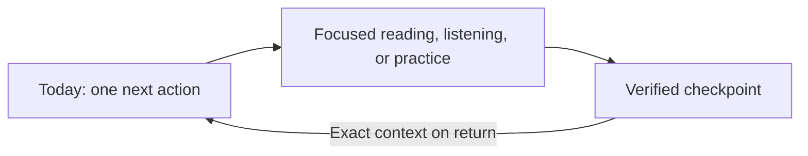

# Hifzer UI/UX audit — target experience

Date: 2026-09-04
Status: Implementation-ready recommendation; not yet user-validated

[Executive report](README.md) · [evidence coverage](coverage.md) · [findings](findings.md) · [delivery roadmap](roadmap.md)

## 1. Target outcome

Hifzer should feel like a calm Qur'an continuity companion. Every return should answer one question first: **what is the most meaningful next action I can take now?** The product then needs to carry the person into reading, listening, memorizing, or reviewing without losing their exact place, effort, or confidence.

The proposed experience is deliberately not a generic activity dashboard, a gamified devotional scorecard, or an AI-first answer engine. It prioritizes:

- one recommended next action, with a short reason and a low-friction alternative;
- precise continuity across ayah, page, mode, translation, reciter, repeat settings, and audio position;
- visibly different reading, listening, memorizing, and reviewing states;
- capture-first bookmarks and reflections that are durable before they are called saved;
- canonical Qur'an/source content separated from optional AI synthesis;
- recovery language that is calm, specific, and never shaming;
- a compact, stable information architecture across phone, tablet, and desktop;
- WCAG 2.2 AA as the release baseline, with 44–48 px ergonomic targets as the product default.

### Product promise

> Open Hifzer, see the right next step, continue exactly where you stopped, and trust that your progress and private reflections will still be there when you return.

### Non-goals for the first delivery cycle

- No public leaderboard, spiritual rank, streak pressure, or comparative piety signal.
- No broad social/community surface.
- No AI answer without source links, limitations, reporting, and a useful non-AI fallback.
- No redesign of every secondary route before the core continuity loop is reliable.
- No claim of theological authority; content and copy with religious implications require qualified review.

## 2. Evidence that shapes the target

The target below responds to the current implementation and captured runtime evidence, not only to historical design notes.

- The shell currently exposes six mobile destinations and omits Journal (`app-shell.tsx`, navigation definitions and mobile navigation around lines 46–72 and 340–367). The target uses five stable destinations and keeps all existing deep links.
- The Qur'an hub gives substantial visual weight to “Khatmah rank,” badge tiers, and unlock language (screenshots 12, 33, and 34). The target replaces rank with private, descriptive continuity information.
- Reader controls work at common widths but collide at 320 px (screenshots 18–22 and 36); bookmark and audio controls use 32–36 px hit areas in places (`reader-bookmark-control.tsx` around lines 150–184; `ayah-audio-player.tsx` around lines 506–659). The target consolidates controls and uses a 44–48 px default hit area.
- Audio failure UI can expose truncated implementation detail such as environment/configuration names (screenshot 10). The target uses user-safe error copy and sends technical detail only to diagnostics.
- Reader AI identifies itself as beta and can retry, but its source labels are not resolvable citations and it lacks a report/limitations path (screenshot 11). The target separates AI from canonical content and requires citations that open.
- Ask Qur'an validates an empty prompt and shows an unavailable state (screenshots 30–31), but needs a trustworthy source and recovery contract.
- Journal's composer and floating add button overlap at desktop (screenshot 28; `journal-client.tsx` around lines 1393–1404 and 1575–1578; `journal.module.css` around lines 442–460 and 518–523).
- More importantly, screenshot 37 shows “Note saved — This note is saved in this browser,” while screenshot 38 shows the note missing after reload. The likely destructive path is the unresolved/null profile being passed into `ProfileHydrator`, which calls `syncLocalStateOwner`; a falsy owner clears all user-scoped browser data, including the journal prefix (`app-shell-side-effects.tsx` lines 16–100, `profile-hydrator.tsx` lines 21–27, `src/hifzer/local/store.ts` lines 79–168). Engineering should confirm with a focused test, but the target contract is unambiguous: unresolved identity, signed-out identity, and confirmed owner change must be separate states, and only the confirmed owner-change/sign-out path may clear isolated private state.
- Auth-dependent routes could not be fully exercised in the local environment; dashboard, Hifz, and worship exposed honest but generic failure/unauthorized states (screenshots 24, 25, and 29). A configured staging environment with representative accounts remains a delivery dependency.
- Existing strengths to preserve include a visible skip link (screenshot 16), route-shaped loading skeletons, semantic input errors, global focus styling, language/direction bootstrapping, a strong “Continue reading” foundation on Today/Qur'an, guided dua modules with source anchors (screenshots 26–27), and responsive landing behavior at 320 px (screenshot 35).

## 3. Experience principles and decision rules

### 3.1 Continuity before breadth

The core loop is `decide → act → checkpoint → return`. Secondary tools must not displace that loop. If a surface cannot preserve its state across navigation, reload, and temporary connectivity loss, it is not ready to claim success.

### 3.2 One action, not one option

Today presents one primary action. A “Choose another” disclosure may show alternatives, but alternatives never compete at the same visual weight. Recommendation precedence is deterministic and explainable:

1. an interrupted practice or recording that can be safely resumed;
2. due review from an active plan;
3. an interrupted reading/listening position;
4. the next planned reading/listening session;
5. first-run plan setup.

The card states why it was selected, for example “7 ayahs are due from your review plan” or “Resume Al-Baqarah 2:153, 02:14 into audio.” A person can dismiss or choose another activity without penalty.

### 3.3 Progress is mode-specific

Never merge devotional activity into one ambiguous percentage. Keep these concepts separate in the data model and UI:

| Mode | What is recorded | What is shown |
| --- | --- | --- |
| Reading | last ayah/page, translation, timestamp, optional plan checkpoint | “Continue at 2:153” and private plan progress |
| Listening | ayah, reciter, playback position, repeat/autoplay settings | “Resume at 02:14” plus reciter |
| Memorizing | current set, stage, attempts, self/assisted confidence | “Continue new memorization: 3 ayahs” |
| Reviewing | due items, result per item, correction history | “7 due” and completion for this review, not a spiritual score |

### 3.4 Save means durable

“Saved” is reserved for a successful write followed by a read-back or server acknowledgement tied to the same record/version. A state update in React is not proof of durability. If the system only has an in-memory draft, label it “Draft on this screen.” If local storage is durable but account sync is pending, label it “Saved on this device · Sync pending.”

### 3.5 Source authority is visible

Qur'an text, translation, tafsir/source excerpts, Hifzer-authored guidance, and AI synthesis receive distinct labels and containers. AI is opt-in from the reading flow and cannot visually impersonate canonical source content.

### 3.6 Recovery protects dignity and effort

Failure copy states what happened, what is safe, and what the person can do next. It never blames, threatens a streak, or implies spiritual failure. Retry should preserve all user-entered content and restore focus to the relevant control.

## 4. Revised end-to-end journey

The target journey has six named parts so design, engineering, analytics, and QA can use the same vocabulary.

| Journey | Entry and critical path | Verified outcome |
| --- | --- | --- |
| TJ-1 First visit | Public sample → intent/start → realistic cadence → plan preview → five-minute action | First action starts with choices preserved |
| TJ-2 Return | Resolve identity without destructive clearing → compute one explainable next action → Start/Resume | Correct mode and context open |
| TJ-3 Read/listen | Restore ayah, view, translation, reciter, and audio position → act → checkpoint continuously/on exit | Exact context survives return |
| TJ-4 Practice/review | Permission preflight → recall/record → process → confidence-aware feedback → repair → schedule | Result is inspectable and system uncertainty is separate from learner performance |
| TJ-5 Capture | Bookmark/Reflect → immediate local draft → optional detail → verified local save → optional account sync | Same record reloads and backlinks to the exact ayah |
| TJ-6 Ask | Ask in context → canonical matches/sources → optional labeled AI synthesis → cite/report/retry/fallback | Sources open and a non-AI route remains available |

The everyday loop should feel shorter than the full journey map:

## 5. Target information architecture

### 5.1 Stable primary navigation

Use the same five primary destinations across widths:

1. **Today** — recommendation, continuity, and a quiet weekly summary.
2. **Qur'an** — read/listen, browse surahs, plan, and private completion history.
3. **Practice** — Hifz, review, fluency, and active sessions under one clear mode hub.
4. **Journal** — reflections, bookmarks, linked ayahs, and personal duas.
5. **More** — Dua, Trackers/Worship, Qur'an words, Ask Qur'an, Settings, Support, and What's next.

Route aliases and deep links remain valid. This is a presentation/mental-model consolidation, not an immediate URL migration. `/hifz`, `/practice`, and `/fluency` can initially share a Practice entry point; a later route migration must preserve redirects, query state, analytics, and browser history.

On desktop, the first four destinations may remain visible in the rail/sidebar and More opens a grouped secondary list. If product evidence shows Dua is a high-frequency peer, desktop may expose it within the expanded sidebar while the five-item mobile model stays unchanged. Do not personalize the physical order; stable location supports memory and assistive technology.

| Compact option | Benefit | Tradeoff | Decision |
| --- | --- | --- | --- |
| Keep six current items | Minimal implementation change | Labels and targets remain crowded; Journal and learning/help stay stranded | Reject |
| Four items: Today, Qur'an, Practice, More | Maximum space and clarity | Journal becomes harder to reach despite being a core capture lane | Keep only as a usability-test fallback |
| Five items: Today, Qur'an, Practice, Journal, More | Stable core loop, truthful overflow, adequate label space | Dua moves one level deeper on phone | **Recommend and validate** |

The five-item model is the final recommendation for implementation behind a feature flag; destination tests should determine grouping and copy, not reopen an unconstrained navigation redesign.

### 5.2 Screen hierarchy

Every core screen follows this hierarchy:

1. current context and state;
2. one primary action;
3. immediate supporting controls or explanation;
4. secondary exploration;
5. account, technical, or educational detail behind disclosure.

Avoid placing marketing-style hero copy, rank badges, or large decorative cards above the current task once the person is inside the app.

## 6. Screen-by-screen target specification

### 6.1 Public landing and authentication

**Purpose:** let a visitor understand the continuity promise and try meaningful Qur'an reading before being asked to create an account.

**Target hierarchy:** concise promise → “Open Qur'an” primary action → “Set up a plan” secondary action → three trust points (privacy, sources, continuity) → deeper feature explanation.

**Behavior:**

- Keep the anonymous reader available with a visible explanation of what will and will not persist.
- Ask for sign-in only when the person chooses cross-device continuity, a protected practice feature, or account sync. Preserve the intended destination and reading context through authentication.
- If authentication is not configured or temporarily unavailable, show “Sign-in is unavailable right now,” keep “Read Qur'an without signing in” available, and offer Retry. Do not expose platform configuration or raw provider errors.
- Do not promise that anonymous bookmarks or notes persist unless a verified device-local store is available and the storage scope is clear.

**Acceptance:** a first-time visitor can enter the public reader in one activation; login failure does not dead-end reading; redirect returns to the same route/query after authentication.

### 6.2 TJ-1 onboarding: realistic first plan

Replace the current detailed assessment followed by a separate first-run tutorial with a two-stage setup and contextual teaching.

**Stage 1 — Choose the intent:** “Read consistently,” “Listen,” “Memorize new ayahs,” or “Review what I know.” Do not default to Hifz merely because of the product name.

**Stage 2 — Set a starting point and cadence:** show three cadence presets such as “Gentle · 5 min, 3 days/week,” “Steady · 10 min, 5 days/week,” and “Custom.” Starting surah/ayah is required; teacher status, translation, reciter, and fine-grained schedule remain optional and can be changed later.

Then show a compact preview: next action, estimated time, and what Hifzer will remember. The primary button is “Start my first session,” not “Finish setup.” Qur'an.com linking is contextual when cross-device history or enriched content is requested, not a gate to first value.

**States:** initial, validating, saving, saved, local-only, retryable error. Retain selections across Back, reload, and auth interruption. Do not show another multi-step dashboard guide; use one-time, dismissible hints at the moment a feature is first encountered.

**Acceptance:** a new person reaches a five-minute or shorter first action after at most two required decision screens; Quick start is editable before commit; setup failure preserves all selections.

### 6.3 TJ-2 Today: one recommended next action

Today is the default authenticated landing surface and the only screen responsible for cross-mode recommendation.

| Visual level | Example content | Action hierarchy |
| --- | --- | --- |
| Context | “Good evening” plus a quiet storage/sync status | No competing CTA |
| Primary card | “Review 7 due ayahs · about 8 min” and “From your Al-Mulk review plan” | **Start review** primary; Choose another secondary |
| Continuity row | “Continue reading · Al-Baqarah 2:153” | Resume tertiary |
| Private history | “This week · 3 sessions · 42 min” | View history disclosure |

**Target behavior:**

- Render the recommendation from a single server/client contract with `kind`, stable `activityId`, reason, estimated duration, target route, and context/version.
- If recommendation data is loading, reserve the card's final dimensions. If it fails, fall back to the last verified local continuation and label it “Last saved on this device.”
- “Choose another” opens a compact list of the other modes; selecting one does not permanently rewrite the person's plan unless they explicitly choose “Make this my default.”
- Show weekly continuity as descriptive history (sessions, time, items reviewed), not a rank or moral evaluation. Missed days use neutral language such as “Ready when you are.”
- Remove the separate multi-step first-run dashboard guide after the simplified onboarding ships.

**Acceptance:** one and only one primary action appears above the fold; its reason is readable; the action reaches the correct mode/context; a failure still offers a valid local continuation or a clear setup action.

### 6.4 App shell and More

**Phone:** fixed five-item bottom navigation, safe-area aware. The focused reader/practice session may suppress the global bar only when an equally discoverable Exit/Back action is present and no content is obscured. Journal must be a primary destination.

**Tablet:** compact rail at the inline start edge; labels appear on focus/selection or when expanded. Do not reuse the phone bar when a rail reduces occlusion.

**Desktop:** sidebar/rail with primary destinations, then grouped secondary destinations. Preserve the existing active indicator, skip link, and collapsible grouping, but do not let collapsed state hide the current route label.

**More:** use a sheet on phone and a popover/panel on larger screens. Group items by “Guidance” (Dua, Ask Qur'an, Qur'an words), “Tracking” (Trackers/Worship), and “Account & help” (Settings, Support, What's next). The sheet has a real heading, focus containment, Escape/close behavior, and focus return.

**Acceptance:** 3–5 mobile destinations, no horizontal scrolling, selected state is conveyed beyond color, all existing destinations remain reachable in two activations or fewer from a primary screen, and browser Back behaves predictably.

### 6.5 Qur'an hub

Reorder the current hub around continuation:

1. exact “Resume reading/listening” card;
2. active plan and next checkpoint;
3. browse/search by surah, juz, or saved place;
4. optional tools/integrations;
5. private history behind a disclosure.

Remove “Khatmah rank,” named status tiers, badge unlocks, shimmer/glow celebration, and “Ahl Al-Qur'an Path” progression. A private completion record may say “1 completion recorded” or show the date and reading plan, but it must not imply spiritual standing or competition.

Plan editing should continue to use practical presets, but Save follows the same verified state contract as journal data. When the plan changes the next action, preview that change before commit.

**Acceptance:** the first interactive card resumes exact context; no rank/badge copy remains in the core flow; plan save survives reload and reports local/account scope.

### 6.6 TJ-3 focused reader and listening

The reader should separate navigation, content, playback, and optional tools.

| Reader region | Contents | Responsive rule |
| --- | --- | --- |
| Header | Back; Surah/ayah context; text/display; More | One stable row; long names truncate without hiding the reference |
| Content | Qur'anic Arabic; selected translation/transliteration | Full-width reading measure; Arabic semantics remain explicit |
| Player | Play/Pause; elapsed/total; seek; speed/repeat/next | Primary playback stays visible; advanced controls disclose on narrow screens |
| Ayah actions | Bookmark; Reflect; Sources; Explain with AI | Source and capture actions remain distinct; AI stays optional |
| Navigation | Previous ayah; Next ayah | Sticky only when it cannot obscure content or global navigation |

**Context contract:** checkpoint `{surahId, ayahId, pageOrListView, scrollAnchor, translationId, translationVisible, phoneticsVisible, textScale, reciterId, audioMs, repeatCount, autoplay, mode, updatedAt, version}`. Persist on material change with a debounce, on `visibilitychange`, before route exit, and at explicit Next/Previous. Server reconciliation chooses the newest valid version while keeping a recoverable device checkpoint until acknowledgement.

**Controls:**

- Replace Link-styled toggles with semantic switches or segmented controls that expose current state.
- Put text/translation/display controls in an accessible settings sheet; the toolbar keeps only Back/context, display, and More.
- Use a persistent mini-player within the reader viewport. Play/Pause is always 44–48 px; the seek control has a visible track/thumb, keyboard steps, elapsed/total text, and an accessible value.
- Repeat, speed, reciter, and autoplay live in a playback disclosure on narrow screens; the most-used setting may remain adjacent on tablet/desktop.
- Bookmark and Reflect open the same capture system described below. Anonymous disabled actions show an inline explanation on activation or remain available as local-only where privacy policy permits; do not leave permanent helper text colliding with the toolbar.
- Previous/Next controls remain sticky only if they do not cover ayah content or the global navigation. Account for `env(safe-area-inset-bottom)`.
- Technical source/configuration details never render in user error copy. A diagnostics ID may be copied from a Help disclosure.

**Reader states:** restoring context, ready, audio resolving, buffering, playing, paused, checkpoint pending, checkpoint saved locally, sync pending, offline, recoverable error, source unavailable. Announce meaningful state changes politely; do not announce every time tick.

**Acceptance:** at 320 CSS px and 200% zoom there is no collision or two-dimensional page scroll; exact context restores after reload and on another device when synced; pausing at time `t` resumes within ±2 seconds; changing translation/reciter persists; all primary controls meet the 44–48 px target.

### 6.7 TJ-4 Practice: memorization and review

Practice starts with an explicit mode choice when no recommendation exists: “Memorize new,” “Review due,” “Fluency,” or “Listen and repeat.” During a session the label and progress denominator always refer to that mode.

**Session structure:** goal/context → microphone preflight when required → active recall/recording → processing → inspectable feedback → self-correction/confirm → next item → session summary.

**Feedback contract:**

- Identify the ayah/word/segment affected and provide the recognized text where permitted.
- Encode correct, needs attention, skipped, uncertain, and system error with icon + label + pattern/outline, never color alone.
- Show model confidence as plain language (“Low confidence—please check”) rather than false precision.
- Allow “I said this correctly,” “Mark for teacher,” replay, and retry without erasing the original attempt.
- Distinguish user performance from system inability: permission denied, no speech, noisy audio, network loss, unsupported browser, processing timeout, and low-confidence transcription each get a different recovery.
- Schedule review only from a confirmed result. A system failure never lowers progress or confidence.

**Acceptance:** microphone permission is requested in context; denial still offers a manual/self-grade path; each feedback item is operable by keyboard and screen reader; a failed upload keeps the recording locally until retry/discard; ending a session yields a checkpoint that drives Today.

### 6.8 TJ-5 Journal and bookmarks: capture first, organize later

Use one capture model for bookmark-only, bookmark + note, and reflection.

**From an ayah:** activating Bookmark immediately creates a verified local record for that ayah and returns “Saved on this device.” Reflect opens a bottom sheet/editor with the ayah already attached. Title, note type, and tags are optional at capture; organization can happen later.

**In Journal:** New reflection is an in-flow button near the page heading and empty state. A floating action button may appear only while browsing a long list; it is hidden while a composer is open and can never cover Add tag, Save, or the mobile bar.

**Durability state contract:**

| UI state | Required technical proof | User label/action |
| --- | --- | --- |
| Draft | in-memory only | “Draft on this screen” |
| Writing locally | write initiated | “Saving on this device…” |
| Saved locally | same id/version read back from durable local store | “Saved on this device” |
| Sync pending | local verified, account request queued | “Saved on this device · Sync pending” |
| Synced | server acknowledges id/version and read model contains it | “Saved to your account” |
| Conflict | local and server versions diverge | preserve both; “Review two versions” |
| Failed | write/read-back fails | retain draft; “Not saved yet · Try again / Export” |

Identity is a tri-state contract: `resolving`, `signedOut`, or `signedIn(ownerId)`. `resolving` must never call a destructive clear. Signing out isolates the previous owner's data; deletion requires a dedicated, confirmable policy path rather than piggybacking on profile hydration. Keep a device recovery copy until the server version is acknowledged. Test storage blocked/quota-full/private-mode conditions.

Deletion is undoable for a short interval; auto-delete shows an exact date/time and a cancel action. Leaving with an unsaved meaningful draft triggers autosave first and, if that fails, a confirm dialog that describes what would be lost.

**Acceptance:** create → save → reload → navigate away/back retains the same record; local and account scopes are truthful; account switching never exposes another owner's data and never deletes it merely because identity is unresolved; offline edits survive and later sync; every linked ayah opens the exact reader location; the composer has no overlapping controls from 320 px through desktop.

### 6.9 TJ-6 Ask Qur'an and AI explanation

AI remains secondary to the Qur'an and cited sources.

**Answer hierarchy:** query/context → canonical ayah matches → source/tafsir links → clearly labeled “AI synthesis” → limitations/report controls. Within the reader, “Sources” is available without invoking AI; “Explain with AI” is an explicit action.

**Required disclosure:** provider/data-processing summary, whether the question/ayah is sent externally, that output may be incomplete or wrong, and a reminder to seek qualified human guidance for consequential religious questions. Keep the copy brief in context and link to full privacy/method notes.

**Citation contract:** each claim group has at least one resolvable source chip with title, source type, and destination. Opening a citation preserves the query and answer when returning. Source labels that do not open are not citations.

**Failure/fallback:** preserve the prompt; show relevant Qur'an search results or a source browse path; Retry remains available; report accepts category and optional note but does not require re-sending the full private query. User-visible copy never includes raw payloads, stack traces, provider names that are not part of disclosure, tokens, or environment variables.

**Acceptance:** AI is never required to read canonical content; every rendered AI answer has disclosure, citations, and Report; citation links resolve; prompt survives timeout/retry/navigation; an unavailable AI response still offers a useful source/search path.

### 6.10 Dua and guided modules

Preserve the current module/step model and visible source anchors. Dua remains directly deep-linkable and can become Today's recommended action when explicitly planned, even if it lives under More in the compact navigation.

Reset/restart actions require confirmation when they remove progress and offer Undo when feasible. Completion language stays private and descriptive. Linked journal capture uses the same verified durability states as ayah capture.

### 6.11 Settings

Replace the horizontally scrolling category cards seen at 390 px with a vertically grouped settings index. Groups are Display & language, Reading & audio, Plan & reminders, Privacy & data, Integrations, and Account/help. Search is optional only if the list grows beyond a single scannable page.

Every setting uses the correct semantic control and displays scope (“this device” or “your account”). Optimistic updates may be used, but a failed persistence request must roll the control back or mark it unsaved; silent failure is not allowed. Theme changes can preview immediately and expose Reset to default.

### 6.12 Global loading, empty, auth, and error screens

Preserve content-shaped route skeletons and the existing skip-link/focus foundation. Standardize recovery surfaces around:

1. plain-language title;
2. what is safe or preserved;
3. one primary recovery action;
4. one viable alternate path;
5. optional diagnostics/reference ID.

Examples:

- “We couldn't load your dashboard. Your saved place is still on this device. [Try again] [Open Qur'an]”
- “Microphone access is off. You can enable it in browser settings or continue with self-grading.”
- “Audio is unavailable for this reciter. [Try another reciter] [Read without audio]”

Never substitute a raw 401/503/plain-text configuration message for an in-app recovery screen in a normal browser navigation.

## 7. Responsive behavior

| Concern | Phone 320–479 px | Tablet 480–1023 px | Desktop ≥1024 px |
| --- | --- | --- | --- |
| Navigation | five-item bottom bar; More sheet; safe-area padding | start-edge compact rail | expanded/collapsible sidebar |
| Primary content | single column; 16 px gutters at 320; no fixed card minimum width | one main column, optional contextual rail | main + optional contextual rail; cap reading measure |
| Today | one full-width next-action card; secondary actions collapsed | next action + quiet summary | next action remains dominant; summary may sit beside it |
| Reader | minimal top bar, full-width content, settings sheet, compact mini-player | toolbar can expose one extra playback control | player and tools may be inline, Arabic text measure still capped |
| Practice | one task per viewport; feedback in stacked rows | split prompt/feedback when useful | two-pane source + feedback only if reading order stays logical |
| Capture | bottom sheet/full-height sheet; keyboard-safe | anchored sheet/dialog | anchored panel or modal; no FAB over composer |
| Settings | vertical grouped list | vertical groups, two-column detail where clear | index/detail layout |
| Targets | 44–48 px default | 44–48 px default | 40 px may be accepted for dense secondary controls only; primary remains 44 px |

Additional requirements:

- Use CSS logical properties (`margin-inline`, `inset-inline-start`, etc.) and avoid direction-specific positioning unless content truly requires it.
- At 320 CSS px, 200% text zoom, and mobile landscape, no content/control collision or horizontal page scrolling is permitted. A deliberately horizontal data visualization is the only documented exception and must have its own labeled scroll region.
- Sticky/fixed surfaces use shared z-index and safe-area tokens and reserve space in normal flow.
- The on-screen keyboard must not cover the active input, Save, or sheet close action; use dynamic viewport units and focus scrolling.
- Hover is enhancement only. Every hover-revealed action is also visible on focus and available on touch.

## 8. RTL and localization contract

The current root language/direction bootstrapping is a useful base, but target readiness requires component-level mixed-script behavior.

- Set document `lang` and `dir` from a resolved UI locale before paint. Do not infer a person's language from location, account name, or file path.
- Arabic Qur'an runs always use `lang="ar"` and `dir="rtl"`; translations use their own language/direction even inside an RTL shell. User-entered titles/questions use `dir="auto"` with bidi isolation around ayah references, timestamps, email addresses, and Latin source names.
- Mirror structural layout and directional icons, but do not mirror media play, check marks, clocks, or other non-directional symbols. Previous/Next semantics follow reading order and are validated with native speakers.
- Use logical spacing/position tokens; remove hardcoded `left`/`right` from new components. Existing exceptions enter a migration backlog.
- Give Arabic/Uthmani text its own font stack, optical size, and line-height token. Test all themes for diacritic clipping, glyph substitution, and line wrapping.
- Localize labels, empty/error states, aria-labels, toast/status text, dates, times, plural rules, and numerals consistently. Do not hardcode `en-US` formatters in user-facing journal metadata.
- Allow translated strings to expand by at least 35%; do not truncate primary actions or state labels. Tooltips cannot be the only place where a truncated label becomes understandable.

Minimum test matrix: English LTR, Arabic RTL, Urdu RTL with English/Latin source labels, mixed Arabic + localized translation, long pseudo-localized labels, and both light/dark themes at 320/390/768/1440 widths.

## 9. Accessibility release contract

Target WCAG 2.2 AA for all core journeys. Automated tests are necessary but not sufficient.

### Operable and perceivable

- 44–48 px product-default hit area and spacing that prevents adjacent activation; any WCAG 24 px minimum exception must be documented and cannot be a primary reader/session action.
- Visible focus indicator with at least 3:1 contrast and no clipping; sticky headers/bars must not obscure focused elements (2.4.11 Focus Not Obscured).
- Keyboard access to every action, including audio seek/repeat, capture sheets, segmented controls, reordering if retained, and practice correction. Escape closes dismissible overlays; focus returns to the invoker.
- Skip link remains the first useful focus target. Headings, landmarks, lists, and native form elements convey hierarchy before ARIA is added.
- Selected, due, correct, uncertain, failed, and synced states use text/icon/shape in addition to color. All normal/large text, icons, focus rings, and component boundaries meet AA contrast in every theme.
- Text reflows at 320 CSS px and 200% zoom; text spacing overrides do not clip or overlap. Motion respects `prefers-reduced-motion`; meaning never depends on shimmer, pulse, or animation.

### Understandable and robust

- Field errors identify the field and corrective action, use `aria-invalid`/described-by relationships, and keep entered values. Do not rely on browser-native bubbles as the only explanation for range errors.
- Async buttons expose stable labels and pending state; do not disable a whole form without telling assistive technology why. Status messages use `role="status"`/polite live regions; urgent destructive failures may use alert, without duplicate announcements.
- Progress uses `role="progressbar"` with value/min/max where quantitative; a descriptive image role is not sufficient for interactive/task progress.
- Sheets/dialogs have accessible names, focus containment, background inertness, close action, and deterministic focus restoration.
- Audio/practice has a non-microphone/manual path. Recording status is visible and announced; no recording begins without an explicit action and disclosure.
- AI labels, source types, and disclosure are available to screen readers in the same reading order as the visual answer.

### Verification gate

Each release covering TJ-1–TJ-6 requires keyboard-only testing; VoiceOver/Safari and NVDA/Chrome passes; 320 px reflow and 200% zoom; light/dark/RTL contrast checks; touch target audit; reduced-motion check; and zero unresolved critical/serious automated violations. Results are recorded by route and state rather than summarized as a blanket compliance claim.

## 10. Design-system and component plan

### 10.1 Reuse and strengthen

- Keep `Button`, `Card`/`CardSoft`, `Input`, `Pill`, `Toast`, `EmptyState`, `DisclosureCard`, `PageHeader`, and route-shaped loading components.
- Extend Button so loading text is action-specific (“Saving note…,” “Starting review…”) and spinner contrast follows the variant. Use existing medium/large control-height tokens as the default.
- Extend Toast with optional persistent action/Undo and a non-expiring error mode. A toast may confirm a durable action, but cannot be the only durable status indicator.
- Change quantitative progress to progressbar semantics and keep descriptive text visible.
- Standardize error/empty components with preserved-state and alternate-path slots.

### 10.2 Add shared components

| Component | Responsibility |
| --- | --- |
| `NextActionCard` | one recommendation, reason, duration, start/resume, alternative disclosure |
| `AdaptiveNav` + `MoreSheet` | shared destination model rendered as bottom bar, rail, or sidebar |
| `ReaderHeader` + `ReaderSettingsSheet` | stable reading context and semantic display controls |
| `PersistentMiniPlayer` | play/pause, progress, recoverable audio state, compact advanced controls |
| `SaveStatus` | Draft/Writing/Local/Pending/Synced/Conflict/Failed state contract |
| `CaptureSheet` | bookmark/reflection/linked-dua capture with immediate local persistence |
| `SourceDisclosure` | canonical/source/AI distinction, resolvable citations, limitations/report |
| `InlineRecovery` | safe error copy, Retry, alternate action, diagnostics id |
| `ModeBadge` | plain-language reading/listening/memorizing/reviewing distinction |
| `ConfirmOrUndo` | destructive confirmation plus reversible completion pattern |
| `SegmentedControl` / `SwitchField` | semantic settings with visible current state |

### 10.3 Token additions and cleanup

Build on the existing `--kw-*` variables rather than adding route-specific colors and shadows.

- Interaction: `--kw-hit-min: 2.75rem`, `--kw-hit-comfortable: 3rem`, `--kw-focus-width`, `--kw-focus-offset`.
- Layout: `--kw-content-reading-max`, `--kw-content-app-max`, `--kw-safe-bottom`, `--kw-sticky-offset`, and a documented z-layer scale for base/sticky/nav/sheet/dialog/toast.
- State: semantic foreground/background/border triples for info, success, warning, danger, and pending in every theme. Do not encode state with raw green/red utility values.
- Typography: Arabic/Uthmani font family, minimum size, line height, and diacritic-safe leading; translated body and metadata scales.
- Motion: duration/easing tokens plus a reduced-motion value of zero or near-zero for nonessential transitions.

New work should not expand the broad dark-mode utility “compatibility bridge” in `globals.css`. Migrate touched components to semantic tokens as they are changed; remove bridge rules only after visual regression coverage proves no unrelated route regresses.

## 11. Before → after mapping

| Current evidence | Target behavior | Primary implementation area |
| --- | --- | --- |
| Dashboard/first-run guide exposes many peers after a detailed onboarding | two required setup stages, then one explainable next action | onboarding, Today recommendation contract |
| Six mobile destinations; Journal absent | five stable destinations: Today, Qur'an, Practice, Journal, More | `app-shell.tsx`, adaptive navigation |
| Qur'an hub foregrounds Khatmah rank/badge unlocks | resume first; plan second; private descriptive history; no spiritual rank | Qur'an completion/progress components |
| Reader settings look like links and controls collide at 320 px | semantic sheet/segments, compact toolbar, reserved sticky space | reader page, compact reader, audio/bookmark controls |
| Audio errors can expose configuration text | user-safe error + alternate reciter/read path; technical detail in telemetry | audio resolver/player, global recovery |
| “Note saved” followed by note loss on reload | identity tri-state, verified write/read-back, persistent SaveStatus, recovery copy | profile hydration, local owner store, journal store/client |
| Journal FAB overlaps the open editor | in-flow New action; FAB hidden in composer and collision-tested | journal client/module CSS |
| Bookmark capture asks for organization before certainty of save | immediate ayah bookmark, optional note/tags afterward | bookmark control + CaptureSheet |
| AI has labels but no resolvable citation/report contract | canonical sources first; optional disclosed AI; open citations/report/fallback | reader AI panel, Ask Qur'an |
| Hifz/auth failures are generic and full session could not be reached locally | configured-state test environment; mode-specific, effort-preserving recovery | proxy/auth boundary, practice session |
| Settings categories scroll horizontally at 390 px | vertical grouped index with truthful per-setting persistence | settings hub |
| Partial RTL shell with hardcoded English/directional CSS | localized shell/components, logical properties, mixed-script isolation | i18n, tokens, component migration |
| Route skeleton, skip link, focus ring, guided dua/source anchors already help | preserve and formalize as shared release contracts | shared primitives, QA |

## 12. Acceptance criteria by journey

These criteria are release gates, not aspirational copy.

### TJ-1 First visit → realistic first plan

- At most two required decision screens before first action; optional detail is disclosed.
- All choices persist across Back, refresh, and an auth round trip.
- The final preview names mode, starting ayah, cadence, and estimated duration.
- Failure preserves selections and offers Retry plus public Qur'an reading.

### TJ-2 Return → one recommended next action

- Exactly one primary CTA above the fold at 320, 390, 768, and 1440 px.
- Precedence is deterministic, logged by reason code, and independently testable.
- A recommendation opens the right mode and context; “Choose another” never silently changes the plan.
- If remote data fails, a verified local checkpoint or explicit setup action is available.

### TJ-3 Read/listen → exact-context continuity

- Ayah/view/translation/reciter/repeat/audio position persist across refresh, route change, and supported cross-device sync.
- Audio resumes within ±2 seconds of the last acknowledged checkpoint.
- No overlap/horizontal page scroll at 320 px, 200% zoom, or mobile landscape.
- All high-frequency controls meet the 44–48 px target and have keyboard/screen-reader names/states.
- A source/audio failure exposes no implementation secret and always offers an alternate path.

### TJ-4 Practice/review → inspectable feedback

- The active mode is named throughout; reading/listening/memorizing/reviewing progress never merges.
- Permission denied, silence, low confidence, processing timeout, and network failure each have distinct recovery.
- Feedback identifies the affected segment, uses non-color state cues, and can be manually corrected.
- Failed system processing cannot count against progress; recording/attempt is recoverable until explicit discard.

### TJ-5 Capture → durable bookmark/reflection

- Local save is followed by same-id/version read-back before “Saved on this device.”
- Screenshot-37-to-38 reproduction is covered by an automated reload test and passes.
- Unresolved profile state never clears private state; owner switching isolates data without cross-account exposure.
- Offline save, queued sync, conflict, storage blocked/quota failure, sign-out/in, and reload are tested.
- Composer actions remain unobscured; linked ayah round-trips exactly; delete has Undo or confirmation.

### TJ-6 Ask → source-backed guidance and fallback

- Canonical result/source surfaces work without AI.
- Every AI answer displays disclosure, limitations, resolvable citations, and Report.
- Prompt/context survives retry and source navigation; failure provides search/source/human-guidance routes.
- No query or answer content enters analytics, logs, or error breadcrumbs by default.

### Cross-cutting

- WCAG 2.2 AA core-journey test matrix passes with no unresolved critical/serious issue.
- p75 LCP ≤2.5 s, INP ≤200 ms, and CLS ≤0.1 on representative mobile traffic for Today, reader, Practice start, and Journal.
- All state-changing actions report local/account scope and a truthful pending/success/failure state.
- Existing URLs/deep links continue to resolve; feature flags can restore the previous shell/home while leaving data migrations safe.

## 13. Measurement and instrumentation

Instrumentation answers whether continuity works; it must not observe private devotional content.

### 13.1 Common event envelope

Use: `event_name`, anonymous/rotating `user_or_device_key`, `session_id`, `journey_id`, `mode`, `route_template`, `surface`, `source` (recommended/alternate/deep-link), `state_scope` (memory/device/account), `result`, `reason_code`, `duration_bucket`, `app_version`, `locale`, `direction`, `viewport_bucket`, `online_state`, and timestamp.

Never send ayah text, note title/body, dua text, spoken/transcribed audio, AI prompt/answer, email, auth tokens, raw URLs with query text, or raw provider errors. Ayah identifiers may be included only after privacy review and should be excluded from user-level behavioral exports by default.

### 13.2 Event taxonomy

| Journey | Events | Key funnel/quality measure |
| --- | --- | --- |
| TJ-1 | `onboarding_started`, `intent_selected`, `plan_previewed`, `plan_save_started`, `plan_save_verified`, `first_action_started` | setup completion; time to first meaningful action |
| TJ-2 | `next_action_resolved`, `next_action_shown`, `next_action_started`, `alternate_action_opened`, `next_action_completed` | recommendation start rate; completion; reason mix |
| TJ-3 | `reader_restore_started`, `reader_context_restored`, `checkpoint_write_started`, `checkpoint_verified`, `audio_started`, `audio_failed`, `audio_recovered` | resume accuracy; audio recovery; restore latency |
| TJ-4 | `practice_started`, `permission_result`, `attempt_processing_result`, `feedback_corrected`, `review_item_completed`, `practice_completed` | permission recovery; due-review completion; system-failure rate |
| TJ-5 | `capture_opened`, `save_started`, `save_verified_local`, `sync_queued`, `sync_verified`, `save_failed`, `draft_recovered`, `delete_undone` | verified-save rate; note durability; sync recovery; zero data loss |
| TJ-6 | `ask_submitted`, `canonical_results_shown`, `ai_answer_rendered`, `citation_opened`, `answer_reported`, `ask_failed`, `ask_fallback_used` | source-open rate; failure recovery; report rate |
| Shell | `nav_destination_selected`, `more_opened`, `settings_save_started`, `settings_save_verified`, `settings_save_failed` | destination success; backtracking; settings durability |

### 13.3 Initial targets and guardrails

Capture a two-week baseline once event QA is complete, then confirm product targets. Engineering reliability gates do not wait for baseline:

- zero known data-loss reproductions and 100% pass on deterministic journal/plan/checkpoint reload tests;
- ≥99.9% verified local-save completion in supported storage conditions; all failures visibly recoverable;
- ≥99.5% checkpoint record integrity in synthetic tests; field resume accuracy sampled without content collection;
- ≥90% moderated task completion for resume, start review, capture reflection, and open AI citation, including one assistive-technology cohort;
- ≥90% of participants locate a primary destination without opening more than one wrong surface;
- Core Web Vitals at p75: LCP ≤2.5 s, INP ≤200 ms, CLS ≤0.1;
- zero critical/serious accessibility defects at release; no regression in successful public-reader entry.

Product outcome candidates after baseline: reduce median time from app open to meaningful action by 25%; improve successful resume-to-completion by 15%; improve due-review completion without increasing dismissals; and improve capture durability confidence in research. Treat streak/session volume as descriptive, not a goal that overrides wellbeing or trust.

### 13.4 Dashboards and alerts

- Daily reliability: `save_failed`, local read-back mismatch, context restore mismatch, owner-state destructive operation, sync conflict, AI/source failure, audio provider failure.
- Weekly product: time to first action, recommendation acceptance by reason, mode completion, alternate-action use, capture-to-reopen, citation-open, recovery success, navigation backtrack.
- Release slices compare flag cohorts only after sample and privacy review. Roll back UI flags if save/restore errors increase, recovery success drops, Core Web Vitals regress beyond budget, or support reports indicate lost data.

## 14. Dependencies, risks, and safeguards

| Dependency/risk | Impact | Mitigation / release gate | Owner |
| --- | --- | --- | --- |
| Auth and database were not configured for full local audit | signed-in Today/Practice/sync behavior remains partly unverified | create configured staging with new, active-plan, due-review, offline-sync, and account-switch seed users before Next work | Platform + QA |
| Null/unresolved profile currently shares destructive signed-out behavior | journal/bookmark/session loss; false success messaging | introduce explicit identity state machine; destructive clear only on confirmed transition; add reload/account-switch regression suite | Frontend + Platform |
| Local storage can be blocked, full, or evicted | silent data loss | catch writes, read back, persist recovery draft, expose export; document browser support; evaluate IndexedDB for larger/private content | Frontend + Security/Privacy |
| Server/local versions can conflict | overwritten progress or notes | versioned records, expand-only schema, dual read/write during migration, deterministic merge/conflict UI | Backend + Frontend |
| Recommendation logic can feel arbitrary or coercive | loss of trust; wrong mode surfaced | deterministic precedence, visible reason, dismiss/alternate, no moral language, feature flag and cohort review | Product + Data |
| Navigation consolidation can reduce discoverability | Dua/Trackers traffic drop | preserve URLs; More groups; search/deep links; monitor destination success and wrong-turn rate; flag rollback | Product Design + Frontend |
| Audio/AI providers fail or leak implementation detail | broken sessions and trust/privacy risk | adapter-level error codes, redaction, provider fallback, non-AI/non-audio path, monitoring without payload content | Platform + Security |
| AI citations may be weak or unresolved | unsafe religious guidance | citation resolver, allowed-source policy, content/Islamic review, report queue, opt-in launch | AI/Backend + Content Review |
| Arabic/RTL copy and typography lack native QA | misleading labels or unreadable Qur'an text | localization pipeline, pseudo-localization, native Arabic/Urdu review, mixed-script visual regression | Localization + QA |
| Broad dark-mode compatibility rules cause visual regressions | inconsistent themes, hard-to-remove debt | migrate only touched components to semantic tokens; snapshot each theme/width before removing bridge rules | Design System + Frontend |
| Telemetry can expose private behavior | privacy and trust harm | data classification, event allowlist, payload tests, retention policy, no free text/audio, security/privacy sign-off | Data + Security/Privacy |
| Religious motivation patterns can imply judgment | spiritual harm and disengagement | remove rank/leaderboard mechanics, review copy, test recovery language with representative users | Product + Content Review |

### Migration and rollback rules

- Feature-flag `target_today`, `adaptive_nav`, `reader_toolbar_v2`, `capture_v2`, and `source_disclosure_v2` independently.
- Data changes are expand-only until both old and new clients read the new version. Never couple UI rollback to destructive data rollback.
- Keep legacy routes and deep links for at least one stable release after the new shell launches.
- Preserve a verified local record until account acknowledgement; retain conflict copies rather than last-write-wins deletion.
- Every flag has explicit success/rollback thresholds, owner, and kill-switch runbook before exposure.
